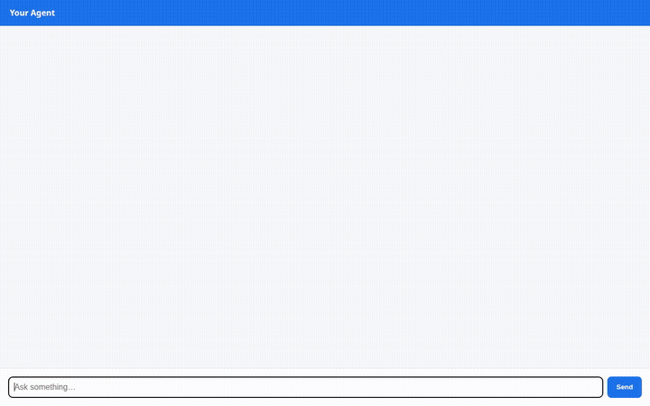

# SomnoCare — Intelligent CPAP Therapy Companion

SomnoCare is a clinical-guidance AI agent designed to assist obstructive sleep apnea (OSA) patients with continuous positive airway pressure (CPAP) therapy. Built using the **Google Agent Development Kit (ADK)** and powered by **Gemini 3.8 Flash**, SomnoCare tracks adherence, analyzes compliance, optimizes environmental comfort settings, and maintains long-term patient context across conversations.

---



---

## What the Agent Does

SomnoCare provides interactive support for sleep therapy routines through structured tools and backend integrations:

- **Cross-Session Memory Bank**: Powered by **Vertex AI Memory Bank**, SomnoCare remembers patient equipment models, mask fit preferences, and historical tolerances across different chat sessions using `PreloadMemoryTool` and automated session-memory extraction.
- **Sleep Therapy Logging & History**: Writes nightly usage hours, Apnea-Hypopnea Index (AHI), mask leak rates, and subjective restedness scores directly to **Google Cloud Firestore** (`sleep_therapy_logs` collection).
- **CMS / Medicare Adherence Analysis**: Evaluates 30-day compliance based on CMS criteria (requiring ≥4 hours/night on ≥70% of days) to help patients maintain durable medical equipment (DME) insurance qualification.
- **CPAP Supplies Catalog**: Queries Firestore (`cpap_supplies` collection) for replacement intervals, mask styles (nasal pillows, full face, nasal mask), and filter maintenance guides.
- **Ambient Weather & Climate Tuning**: Queries the free **Open-Meteo** API for real-time ambient temperature and relative humidity to advise on CPAP humidifier water chamber levels and heated tubing settings, preventing moisture condensation ("rainout").
- **Multimodal CPAP Illustrations**: Generates equipment illustrations and mask diagrams via **`gemini-3.1-flash-lite-image`**, saves the output as an ADK session artifact, and stores the image in a public **Google Cloud Storage** bucket (`somnocare-media-...`).
- **Python Code Execution in Sandbox**: Runs complex statistical modeling, trend computations, and metric simulations safely in a cloud-isolated **Agent Engine Sandbox** (`AgentEngineSandboxCodeExecutor`).
- **A2UI Rich Card Display**: Formats structured responses into rich, interactive display cards using the **A2UI v0.8 Basic Catalog** and an `after_model_callback`.

---

## Architecture & Wired Google Cloud Services

| Capability | Component / Service | Implementation |
| :--- | :--- | :--- |
| **Foundation Model** | Gemini 3.8 Flash (`gemini-3.8-flash`) | Core agent reasoning and dialogue |
| **Image Model** | Gemini 3.1 Flash Lite Image (`gemini-3.1-flash-lite-image`) | On-demand CPAP equipment diagrams |
| **Long-Term Memory** | Vertex AI Memory Bank | `PreloadMemoryTool` + post-session memory callbacks |
| **Database** | Google Cloud Firestore | Structured logs for sleep therapy sessions & supplies catalog |
| **Media Hosting** | Google Cloud Storage | Public bucket storage for generated illustrations |
| **Secure Code Execution** | Agent Engine Sandbox Environment | Isolated Python sandbox execution for custom analytics |
| **UI Protocol** | A2UI (Agent-to-User Interface) v0.8 | Structured JSON card layouts rendered in the web UI |
| **Agent Protocol** | A2A (Agent2Agent) Protocol | Native JSON-RPC / HTTP agent interfaces |

---

## Project Structure

```
somnocare/
├── app/
│   ├── agent.py               # Root ADK agent, tools, callbacks, and sandbox wiring
│   ├── a2ui_utils.py          # A2UI response formatting callback
│   ├── fast_api_app.py        # ADK FastAPI serving app & A2A routing
│   └── app_utils/             # Services registry and session management
├── frontend/
│   ├── main.py                # FastAPI proxy communicating over A2A
│   ├── static/index.html      # Responsive chat interface with built-in A2UI card renderer
│   └── requirements.txt       # Frontend dependencies
├── agents-cli-manifest.yaml   # Agent Runtime deployment manifest
├── deployment_metadata.json   # Remote Agent Engine runtime identifiers
└── pyproject.toml             # Agent package dependencies and tool configurations
```

---

## Running Locally

### 1. Prerequisites
- Python 3.11+
- [uv](https://docs.astral.sh/uv/) package manager
- Authenticated Google Cloud credentials:
  ```bash
  gcloud auth application-default login
  ```

### 2. Start the Agent Playground
From the project root:
```bash
uv sync
uv run adk web . --port 8080 --reload_agents
```
Navigate your browser to the local playground interface to interact with the agent.

### 3. Start the Chat Frontend
In a separate terminal:
```bash
cd frontend
pip install -r requirements.txt
export AGENT_ENGINE_RESOURCE_NAME="projects/<PROJECT_ID>/locations/<REGION>/reasoningEngines/<ENGINE_ID>"
export AGENT_DIRECTORY="app"
PORT=8080 python main.py
```
Open your browser to interact with the frontend chat interface.
